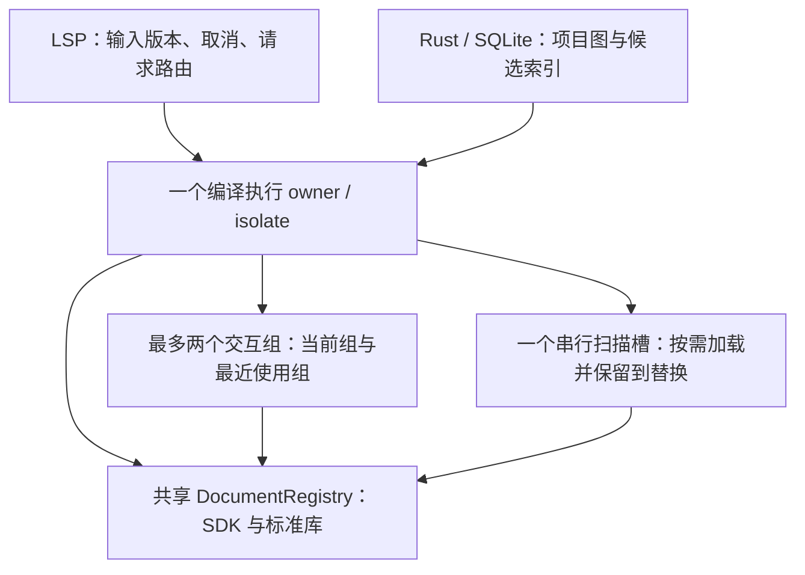

# 语义分组、SDK 初始化与上下文保留设计

日期：2026-10-18。状态：**维护者已授权，按 ADR 0018 实施中**。默认压力改为 4GiB 且可配置；项目首次初始化不受压力值约束。实现与验证状态由 [ADR 0018](../adr/0018-semantic-groups-and-initial-preparation.md) 和其 TDD 记录维护。

目标：项目初始化支付共享 SDK 准备成本；利用用户连续操作同一模块的局部性，避免每次查询重新创建和销毁项目编译状态；全局引用范围保持完整，常驻与扫描状态共享现有内存预算。就绪后完整响应目标仍为 **500ms**，不因冷组切换、普通编辑或回收恢复而豁免。

## 1. 采用的成熟机制与本项目的取舍

| 机制 | 官方依据 | 本项目采用方式 |
| --- | --- | --- |
| 构建配置定义稳定项目 | [tsserver Project System](https://github.com/microsoft/TypeScript/wiki/Standalone-Server-(tsserver)#project-system) 区分 configured、external、inferred project | Harmony 的 workspace/product/module/target 和编译选项决定语义组；查询位置与候选列表不决定组身份 |
| 长期语言服务与共享语法树 | [TypeScript Language Service API](https://github.com/microsoft/TypeScript/wiki/Using-the-Language-Service-API) 定义项目级语言服务、快照和共享 DocumentRegistry | 各组保留自己的 LS/Program，兼容 SDK/标准库 SourceFile 由同一 Registry 共享；编辑交给编译器增量更新 |
| 请求借用，空闲后保留并 LRU 驱逐 | clangd [TUScheduler.h](https://github.com/llvm/llvm-project/blob/main/clang-tools-extra/clangd/TUScheduler.h) 与 [ASTCache 实现](https://github.com/llvm/llvm-project/blob/main/clang-tools-extra/clangd/TUScheduler.cpp) | lease 归零后保留完整上下文；容量或内存压力触发空闲组回收。clangd 当前默认保留 3 个空闲 AST，其单位是文件，与这里的模块组不同 |
| 共享前置准备与按版本调度 | clangd [请求调度](https://clangd.llvm.org/design/threads) 保留 preamble/AST，合并被后续编辑覆盖的工作 | SDK 先准备；同组编辑串行应用、合并尚未开始的重复刷新，读取请求必须使用规定版本 |
| 版本快照复用 | [Roslyn Overview](https://github.com/dotnet/roslyn/blob/main/docs/wiki/Roslyn-Overview.md) 的 Project/Compilation 和不可变快照 | 稳定组身份与可变内容代际分离；借鉴生命周期，不移植 Roslyn 对象模型 |
| 全局覆盖与活跃文件状态分离 | [clangd index](https://clangd.llvm.org/design/indexing) 将动态文件索引与后台全局索引合并 | 保留项目候选索引与当前 overlay；本仓库现有索引仍只提供候选，最终结果由官方编译器验证 |

下文的两个交互组、一个扫描槽是针对本仓库的首版策略，**不是上述工具共同规定的默认值**。扫描隔离借鉴成熟的缓存准入思路；例如 [PostgreSQL buffer ring](https://github.com/postgres/postgres/blob/master/src/backend/storage/buffer/README) 避免一次大扫描冲掉常用缓存。这里不移植数据库替换算法。

## 2. 统一所有权和共享边界



- SDK 预热、交互组与扫描组必须在**实际查询使用的同一编译器 isolate** 内共享 Registry。主线程提前解析再向另一 Worker 发送 JS 对象，不能实现这种共享。
- 初版逐步将现有独立引用 verifier 的准备与查询迁入这个 owner，避免交互 owner 与引用 Worker 各保留一套 SDK。LSP 协议线程和索引 sidecar 继续独立。
- 编译器任务保持串行；保留多个组不增加并行重型 Program 构建。补全、定义、引用、诊断使用同一个组管理器，防止每种能力重复保留一份项目 Program。
- Registry 只共享兼容的 SourceFile；各组仍拥有自己的 Program/Checker。跨组传递声明位置、配置身份和版本证明，不传递 `ts.Symbol` 或复用另一 Program 的 Checker。
- 不同 SDK、编译器或不兼容解析选项使用不同共享桶。同桶内容不变时复用；不能宣称不同配置也永远只解析一次。

## 3. 分组规则

首版以真实构建项目为稳定语义单位：

```text
groupId = canonicalWorkspace + product + module + target + compilerOptionsIdentity + sdkBucketId
```

文件内容版本、查询符号、查询光标、打开文件数量、索引候选集合均不进入 `groupId`。它们更新输入代际或请求计划。

1. 从现有 `HarmonyProjectModel.semanticGraph()` 得到模块、source roots、target、依赖和反向依赖；复用真实包解析与 canonical 路径规则。
2. 组根文件覆盖该构建模块的合法源文件与 ambient 输入；实际 Program 带上必要依赖闭包。共享依赖的语法树通过 Registry 复用，Checker 状态仍按 Program 归属。
3. 同一模块中的相邻文件、不同符号、普通编辑使用同一个上下文。文件增加或删除更新组的根集合与代际，不按路径重新切分其他组。
4. 文件属于多个 target/configuration 时允许多个语义归属；按当前选择查询，不能任意合并不同编译环境。对依赖环或跨模块 ambient 合并，必须建立完整语义闭包；无法证明独立时扩大共同上下文或走完整回退。
5. 无构建配置的工程先按 workspace 建立 inferred group，保留已有全局声明和完整成员语义。不能为得到较小 Program 而凭目录或文件数量认定语义隔离。

**语义组与执行批次分离。** 当前按查询候选排序再切 64 个根文件的做法，不再决定常驻上下文身份。执行批次只负责调度需要检查的组或超大范围回退；候选变化不会重建未改变的组。

单组过大时不自动把它切成几个可独立回答的伪项目。首先实测完整依赖闭包的成本，使用现有有界扫描回退覆盖全部范围；64 个根文件仍只是调度参数，不是内存保证。若一个正确的最小闭包已无法准入，明确报告资源不足。这种情况的 500ms 目标仍判失败；后续拆分需要单独证明作用域、ambient、重导出和引用等价性。

## 4. 初始化顺序

1. LSP `initialize` 完成协议握手与配置收集；`initialized` 后服务端主动开始项目准备，不依赖编辑器额外调用自定义请求。
2. 启动实际编译 owner，解析项目/SDK 身份与模块图。使用与正式查询相同的 Host、完整 SDK ambient 配置和 Registry，主动完成 SDK/标准库解析、SDK 内部路径解析及必要绑定。SDK bootstrap 不含用户项目源，不预查询目标符号。按选定 SDK 支持的声明清单预解析兼容语法，不只预热旧 403-file 样例曾加载的 255 个文件；尚未被引用的 API 声明只进入 Registry，不全部加入 Program 根集合，避免改变 ambient 作用域。项目真正导入这些 API 时仍执行其合法模块解析、绑定与输入校验。
3. 保留共享 SDK/标准库语法树、快照及已见证解析事实，释放 SDK bootstrap 独有的 LS/Program 所有权。其余组随后从共享 Registry 获取语法树；这里不假设绑定对象完全不保留可达状态，内存按实测对象图计。
4. 优先准备第一个打开或实际发生交互的组及其依赖。没有活跃文档时，完成 SDK 准备和项目发现，待文档归属确定后准备对应组；不为了显示就绪而任意预查询一个符号。
5. 明确区分 SDK ready、指定组/能力 ready、全局索引覆盖和 workspace 级就绪。SDK ready 或候选索引 ready 不能单独认证全局引用 ready。
6. 首次准备期间提供进度和取消；到达的真实查询可以加入同一个准备任务，避免第二次构建。查询等待时间必须实测，不通过延迟发请求制造 500ms。

SDK 在消费它的项目会话期间固定保留，普通查询结束、切换模块和常规组驱逐不清掉 SDK。SDK 内容/选择或编译配置不兼容时，旧代际停止发布结果，按 lease 安全结束后替换受影响桶。最后一个消费项目关闭或 owner 退出时释放。初始化记录实际声明清单、解析数、解析设置桶与内存；此前 165.8–167.1MiB 只覆盖已测闭包及其 isolate，不能代替新声明全集的成本。若 SDK 本身已无法容纳，准备失败并报告资源状态，避免反复销毁再预热。

## 5. 查询和更新

- 同组查询获取现有 lease，应用尚未处理的文本/依赖变化，校验当前输入后执行真实编译器查询。请求结束只归还 lease。
- 普通编辑更新 ScriptSnapshot/版本及受影响依赖，不把内容修订加入上下文身份，不无条件销毁整个 LS。编译器可以生成新的 Program；要求复用 LS 和合法未变语法，不要求编辑前后永远是同一个 Program 对象。
- 对尚未开始的连续编辑合并刷新；真实读取到来时立即追到要求版本，不能等待固定 debounce 窗口。更新和等待都计入响应时间。
- 同时到达的同组准备合并为一个任务。取消其中一个请求不销毁其他请求正在使用的组或共享 SDK。
- 打开文本优于磁盘与索引。仅相关组和依赖消费者接收其 overlay；不能把所有 workspace 的打开文件塞进每个 Program。
- 文件内容、缺失候选创建/删除、symlink 重定向、包和编译配置都继续保留当前输入见证。复用不依赖 watcher 必达，也不把缓存命中当作输入未变的证明。
- 发布前仍检查当前版本、依赖、配置及完整搜索范围；过时代际结果不得发布。

## 6. 保留和释放

运行期默认 **4096MiB 压力预算**，支持 `ARKTS_MEMORY_BUDGET_MB` 配置；保留 70%/82%/92%、恢复到 85% 的压力与滞回参数。项目首次初始化全过程不按该压力值准入、trim 或驱逐，仍记录真实内存；运行阶段恢复压力管理。这**不是 RSS 硬上限或已验证内存承诺**。共享 SDK、项目状态、索引及正在构建的状态都必须进入资源观测，不能只报常驻组数量。进程 RSS 只按进程计一次，不能按 Worker 份数相加。

保留两个最近有直接用户交互的组；当前活跃组优先受保护，另一个是近期组。后台诊断、预热和全局扫描不冒充用户访问来更新交互 LRU。文件仍打开只保留其权威文本，不保证其 Program 永不驱逐。

全局扫描另有一个可复用槽，最多一个重型扫描任务在途。该槽也受相同预算控制，不扩大 `maxResidentContexts=2` 的交互保留额度。扫描结束后，其 Program 在槽中保留；下一个不同扫描组需要该槽、配置失效或内存压力发生时才替换。用户开始直接操作该组时，将原上下文转入交互保留，避免复制后重建。

| 事件 | 处置 |
| --- | --- |
| 查询结束 | 归还 lease，Program/LS 留在原槽或交互缓存 |
| A 切换到 B | A 进入近期保留；预算允许时两者都保留 |
| B 返回 A | A 复用，刷新前先应用必要变化 |
| 关闭一个文件 | 保留组，更新打开文本及 source 状态；不立刻销毁 Program |
| 扫描 C、D、E | 复用扫描槽，容量触发 C→D→E 替换；不轮流驱逐活动 A 与近期 B |
| 超过交互组容量 | 从无在途 lease 的近期组中按 LRU 选受害者 |
| 内存压力上升 | 停止预热，优先释放空闲扫描槽，再释放非活动交互组；仍不足时在安全点拒绝新工作或取消可取消的工作 |
| SDK/target/配置失效 | 撤销受影响代际发布资格，lease 安全结束后替换；不影响兼容且未变的其他组 |
| 项目关闭或服务退出 | 释放该项目所有权；最后消费者离开后释放 SDK |

容量不足时可以少于两个交互组或没有扫描槽，不能为保留 A/B 而越过资源准入。活动组仅有保留优先级，不豁免实际内存压力。在途 lease 不被直接驱逐；没有可安全释放对象时停止额外重型构建，不能无限等待或让所有打开文件永久 pin 住内存。

首版不增加固定 TTL、频率评分或多级自适应缓存。无压力时停顿几十秒不构成重建理由；容量、压力、失效和项目关闭已经提供释放边界。释放 LS 使用锁定编译器已验证的 `dispose` 路径；不恢复已知会丢失 Registry 引用所有权的 `cleanupSemanticCache()`。Registry 释放与 RSS 回落分别观测，不把 lease 归零等同于物理内存已回收。

## 7. 全局引用与批次

1. 从活跃组确认真实声明身份及当前版本，准备目标语义范围。
2. 通过受信任的项目/候选证据确定必须检查的组；索引不完整、身份不明或图不完整时保守扩大至完整合法范围。
3. 已保留组直接执行查询；其他组使用串行扫描槽。被复用的 Program 必须覆盖其承担的搜索范围；单纯“文件属于同一个模块”不是完整性证明。
4. 每个组保留当前 anchor 核验、完整依赖与输入边界；声明/usage 的两种投影继续共享同次完整分类搜索。
5. 对重叠依赖产生的 Locations 去重，合并时核验全部必查范围已覆盖。缺失组、发生输入变化或资源不足时不得返回伪完整答案。
6. 全局扫描在组/批次边界让出调度；新的交互工作优先于未开始的扫描和诊断。单次同步编译器调用仍可能阻塞，只有测量和取消检查能说明其上界，不能靠队列优先级承诺抢占。

clangd 的全局索引可以直接保存 compiler-derived references；本仓库当前候选索引不具备这项权威。此设计不以成熟索引的名称跳过现有 compiler 验证，也不重新启用已被否决的 S02 事实索引方案。

## 8. 典型局部性序列

```text
SDK 初始化：一次共享解析
A 内连续查询不同符号：一个 LS 持续复用，不靠相同答案缓存
A 普通编辑再查：更新 A 的编译输入，复用合法未变状态
A → B → A：预算允许时各准备一次，返回 A 不冷建
A 发起跨组引用扫描 C/D：扫描槽发生必要替换，A/B 保留
压力驱逐 B 后再访问 B：重新准备，但共享 SDK 不重新解析；恢复耗时仍计入 500ms
```

## 9. 与现有决策及代码的关系

- ADR 0018 已接受并修订 ADR 0016/0017 的“每个引用 job 在发布前销毁项目 LS、项目 Registry leases 为零”要求。新要求改为：请求发布前归还 lease 并完成输入 fence；被保留项目 leases 明确计数，实际驱逐后验证归零。正常预算的生产路由复用 owner；压力触发的保守隔离回退和显式关闭复用的对照路线继续及时释放项目状态。
- ADR 0014/0015 的长期官方 LS、版本证明、预算和完整回退继续作为基础；本提案把身份从当前仅按 workspace 的上下文管理细化为构建语义组，并把引用扫描纳入同一管理器。近期组驱逐采用活动保护后的 LRU，需显式调整 ADR 0015 已默认启用的成本优先驱逐排序；构建成本继续观测，不再优先于直接用户交互的近期性。其它既有默认不会因这份草案自行改变。
- 修改范围预计涉及初始化调度、Harmony 语义组映射、现有 coordinator 的槽位/lease/释放、引用路由与 verifier 所有权；沿用现有 Host、Registry、SDK lookup witnesses、版本快照和候选索引，不另造 TypeChecker、缓存框架或预算体系。
- 默认参数仅为设计起点。两个交互组加一个扫描槽的峰值、真实大模块闭包和锁定 fork 的跨 LS 共享必须在公开测试与实测中证明，不能由 SDK-only 内存反推。

## 10. 实施与验收顺序

1. SDK 初始化：公开 LSP 初始化/准备进度后，首次真实查询零新增兼容 SDK/标准库解析；SDK 变更正确重建。先证明预热与查询使用相同 Registry/isolate。
2. 稳定组：同组相邻文件/不同符号不更换 groupId、不新建 LS；新增文件不洗牌其他组；target、全局声明、依赖环、重导出均保留完整语义。
3. 延迟释放：查询结束保留，A→B→A 命中原上下文；只有容量/压力/失效事件驱逐，lease 不被越权销毁。扫描不污染交互保留。
4. 增量和取消：编辑、未通知磁盘变化、在途依赖变化、关闭文件、取消某个等待者均不返回旧结果，不误清共享 SDK。
5. 全局引用：活动组外、未打开文件、索引不可用、大模块回退和两种声明选项的精确 URI/UTF-16 Location 均与完整官方 compiler oracle 等价。
6. 性能和内存：首次准备独立报告；就绪后未查询符号、同组编辑、A→B→A、冷组切换、压力恢复与跨组引用全部计完整响应时间，按当前 500ms 要求判定。补全同时遭遇长扫描的排队尾时延也纳入。
7. 按真实连续使用序列观察 LS 创建/销毁、Program 准备/复用、SDK parser 调用、峰值及稳态 RSS/heap、驱逐原因与恢复代价；单独保留全局扫描压力测试。GC 诊断与正常性能测量隔离。
8. 每片先有公开 framed-stdio RED，再最小实现 GREEN；最终跑 focused suites 与完整 `pnpm check:fast`。上一轮 1872/1872 仅验证旧实现，不认证本提案。

维护者已按 ADR 0018 授权实施；尚无本设计全部实现或 500ms 通过结论。Context7 本次连接失败，以上行业机制改用所列官方文档与源码核验。
