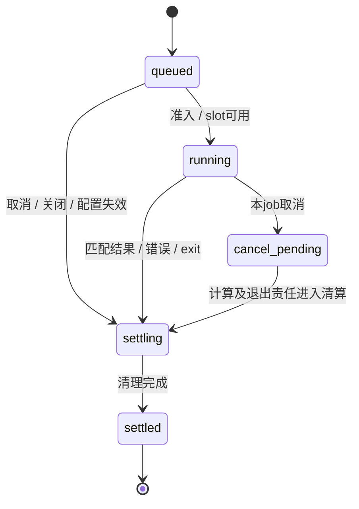

# PR119：验证 Worker 的逐 job 所有权与状态转换评审

日期：2026-11-24。状态：**Proposed 设计；2026-11-25 已授权实施，最终本地 check:fast 2807/2807；独立审阅/平台CI待完成；未合并或部署**。

固定审查候选：`c869ade983006c700c49e883d02340e120c0ea9d`，PR119；源码位置以
`/private/tmp/arkts-lexical-reference-probe-20261123` 为准。
事实依据：[PR119 根因报告](../reports/2026-11-24-pr119-merge-gate-root-causes.md)，
`.bench/pr119-diagnosis-20261123/{summary,history-context-ownership}.json` 及逐轮原始记录。
本文件不把建议改写为既有 ADR 的 Accepted 决策，也不替代最终全检。

正式决策草案：[ADR0049](../adr/0049-verifier-job-context-and-lifetime.md)，状态 Proposed；实施与验收进度见[修复记录](../tdd/2026-11-24-verifier-job-ownership.md)。

## 结论

**采用现有监督机制，补齐 ReferenceVerifierClient 的小型 job 状态机，并显式绑定逐 job 上下文及响应身份。**
状态机约束“谁可以做什么、何时释放”；上下文绑定保证执行时读取谁的取消与证明数据。
两者不可互相替代。不引入通用状态机库，不重写全局调度，不另建恢复预算、计时器监督或业务版本体系。

本案不是 Node Worker 进程内存阈值问题。这里的 semantic Worker、验证 Worker 均是 Node Worker **线程/isolate**；
语言服务器是宿主进程，native index 是另一进程。不得以线程数计算重复的整进程 RSS。

Linux parent-retarget 恢复后持续 `-32803` 的具体证明拒绝点仍未知，单列继续诊断；
不能因它同样涉及“状态”就纳入本设计的已解决范围。

## 1. 已有机制与应保留的边界

| 层级/现有代码 | 当前已有的约束 | 本轮应做什么 |
| --- | --- | --- |
| `lsp/request-freshness.ts:43` | LSP 调用取消、新鲜度、first winning reason、finish 时解除监听 | 复用；不在 verifier 再建文档新鲜度管理器 |
| `semantic-worker-supervisor.ts:105,233,350,512` | root epoch、请求 ID、独立取消单元、revision/version、mutation 优先、单 active + detached references、终态接收 | 保留为外层权威；不复制完整父层状态机 |
| `worker-protocol.ts:420` | CAS 将 active 变为首个终态取消原因，不清零重用单元 | 保留；不能为了 B 恢复而清除 A 的取消 |
| `semantic-cancellation-scope.ts:31` | AsyncLocalStorage 让并发请求 Promise 链读取各自单元；安全同步区例外 | 补跨复用事件边界的绑定，不改同步提交政策 |
| `project/resolution-input-admission.ts:13` | 每命令的证明 rebase/未通知 namespace 观察域，finally 清空 | 与取消上下文一起恢复，不另造长期“已校验”状态 |
| `semantic-worker-progress.ts:24,45` | executing/Program/checker/terminal-produced/sent 观测 | 继续观测；phase 不能成为完成或新鲜度证明 |
| `semantic-worker-watchdog.ts:30` | 未阻塞父端负责绝对截止与取消宽限 | 不在可能同步卡住的验证线程内新建 watchdog |
| `semantic-worker-failure-recovery.ts:17` | 单 pending 恢复、输入资格、频率/累计预算、退避/熔断/半开 | 继续作为宿主语义 Worker 故障恢复唯一权威 |
| `semantic-worker-retirement.ts:5`、`semantic-worker-recycle.ts:23` | 物理退出责任、退出后替换、最新输入重放、调用方停止等待不等于 quiescent | 保留；nested verifier 也必须遵守物理退出屏障 |
| `references/reference-verifier-client.ts:19` | Promise 串行链、busy/retire、termination、局部 settled；复用 SDK Worker | 缺口集中于此：把分散条件收敛为 slot/job 所有权与转换 |
| `references/reference-verifier-worker-runtime.ts:116–130` | LS dispose 在结果发布前；dispose 抛错时不能当正常结果 | 保留，不把结果先 resolve 再做资源清理 |
| `type-engine.ts:65,174,182,462,479` | registry 持有 verifier；SDK/config reset、显式压力释放、owner dispose | 区分可重用 reset 与最终 close，调用仍属于原 registry |

已有状态机有些以字段/Promise 实现，不是都使用 enum；本案并非“项目从未设计过状态机”。
`settled=true` 能防重复 resolve，但不保证 callback 在正确上下文执行；队列串行也不保证任务身份正确。

### ADR 对照

| ADR / 段落 | 应继续满足的约束 | 需要补充或澄清 |
| --- | --- | --- |
| [0006 Context/decision](../adr/0006-semantic-request-scheduling.md) | detached references 与交互隔离、逐请求取消、mutation 后旧结果失效 | “逐请求 async context”还必须覆盖跨任务 Worker 消息边界 |
| [0016 Decision](../adr/0016-reference-verifier-sdk-cache.md) | 单串行 verifier、跨 root 排队取消不杀别人的 active job、保留兼容 SDK、项目状态先清理后发布 | 明确 job 上下文不能成为 Worker 生命周期的一部分；取消释放是未完成 job 的取消，不能把已结清 job 的外层迟到取消作用于 B |
| [0017 Decision](../adr/0017-reference-shared-inputs-and-search.md) | 沿用 SDK/标准库复用、完整覆盖与输入终检 | 本方案不改变 AST 兼容键或结果完整性 |
| [0020 决定4/5、边界](../adr/0020-failed-semantic-build-recovery.md) | 不重放已执行旧请求、单终态、物理退出、共享恢复预算、租约结清 | nested verifier 的真实致命故障如何进入既有恢复域，须明确接线；现有 client 自身无预算，不能假称已自动继承 |
| [0023 决定1/2](../adr/0023-completion-cancellation-and-synchronization.md) | 有限原地同步安全提交、取消不销毁健康主 LS、真实资源故障不吞掉 | job 状态不能把 cancel-requested 当同步已停止 |
| [0024 10-27 补充](../adr/0024-partial-initialization-and-progressing-synchronization.md) | 准备检查点、独立 mutation 不继承请求取消 | 这是另一边界，不能拿它当 verifier message 已绑定的证明 |
| [0026 状态与时间合同](../adr/0026-cancellation-grace-terminal-handoff.md) | produced/sent/received/settled 不混淆；计时单调，不改宽限和绝对截止 | 将 nested job 的结果/释放边界具体化，父层既有合同不替换 |
| [0027 决定](../adr/0027-completion-details-diagnostic-priority.md) | 单编译 owner、有限优先、公平性、mutation 屏障 | 不为修上下文增加并发或优先级特例 |

ADR0016 对“cancellation releases cached Worker”的文字范围须在实施时明确追加解释，不能默改历史。
本建议不扩大为取消所有外层请求时都终止空闲缓存，也不允许取消实际运行中的 job 后立即复用其 Worker。
ADR0020/0026 当前状态与历史收据按原文保留，本文件不追认新的审阅/Accepted 状态。

## 2. 三种选择

| 方案 | 收益 | 局限/风险 | 评审 |
| --- | --- | --- | --- |
| A：只给回调绑定当前上下文 | 改动最小，直接消除本次读错取消域 | busy/retire/termination 分散，迟到响应仍无 job ticket；reset 与 shutdown 的语义仍混在 dispose | 可作完整修复第一片，但不能据此关闭全部生命周期验收 |
| B：明确 verifier job 状态机 + 上下文绑定 + 内部 ticket，复用父层恢复 | 针对实际缺口，覆盖取消、终态、退出、复用与资源归属；保留 SDK 热态 | 小幅内部协议/调用方变动；必须实测竞态与清算，避免引入第二份状态真相 | **推荐，最小完整方案** |
| C：将 nested jobs 全部并入/重写父层 Worker 状态机 | 理论上全链路统一可见 | 父层不持有 verifier 的 LS/SDK/回调资源；需跨 isolate 复制各 batch 状态，易混合外层请求与内层多 job、扩大故障面 | 当前不建议；只借用既有故障入口及观测，不搬迁内部所有权 |

推荐 B 的“状态机”是小模块的受限转换/类型联合，不是新调度框架。
外层一次 references 请求可以产生多个 anchor/batch/fallback jobs；不能把它们压成同一个 request state。

## 3. 所有权与身份

1. **父进程/root supervisor**：root epoch、LSP/内部 request ID、取消首因、revision/version、最终新鲜度和恢复准入。
2. **semantic registry**：一个 verifier client、配置重置及最终关闭；继续拥有交互 Program，不把它转交新管理器。
3. **verifier client**：一个物理 slot、串行 job 队列、每 job 回调、定时器/监听、结果与 drain、终止 Promise。
4. **job record**：入队时捕获本次请求执行上下文、原取消来源、查询输入引用，分配不可复用 jobId；派发时一次性绑定 ticket。
5. **verifier runtime**：当前 job 的项目 LS/Registry leases，响应前 dispose；仅允许已决策的 SDK 缓存跨 job。

内部 ticket 最少为 `{ verifierGeneration, jobId }`；jobId 在 client 内单调，generation 对应实际 Worker handle。
尚未派发的 queued job 不假造 generation；取消后不得换一份 ticket 自动重试，新的显式操作创建新 job。
现有父层 epoch/id/revision/version 不在这里复制成第二套权威；可作为日志关联元数据。
跨 root job 必须绑定自己的 root/输入/配置数据，不能从共享“current request”变量取。

job 创建时捕获 `AsyncResource`，用 `runInAsyncScope` 包裹消息、error/exit、取消和队列续作的任务入口。
不缓存一次 `isCancelled=false`；回调仍动态读取**自己的**单元。工作完成后 emitDestroy/解除引用恰好一次。
基础设施的 Worker 创建/持久监听在 registry 的 owner 中性上下文运行，不在 A 的请求域中创建长期资源；
这一上下文必须在无请求的装配阶段捕获，不能在 A 中临时创建一个名叫 owner 的 AsyncResource 就宣称中性。
既有 runtime 在模块启动阶段装配 engine，是可利用的边界；非生产临时 client 入口亦需核对。

**先验证 handle/generation/ticket 与 job 状态，再进入 job 上下文。** 终态后的旧回调不得借机重入已释放上下文。
只绑定 cancellation 谓词不足以保证其他 request-local 证明/trace 域也正确，应恢复任务的完整执行上下文。

## 4. 最小状态集合

### 物理 slot（不是全局语义服务状态）

`absent | live | retiring | closed`。

- absent：无物理 handle，可以在有效新 job 准入后惰性创建。
- live：持有 `{worker, generation, activeJob?}`；idle/busy 从 activeJob 派生，不再另存 busy。
- retiring：持有原 handle 和**唯一** drain/termination Promise；含完成后 absent/closed 的意图。
- closed：owner 最终关闭，不接受新 job。不能由下一次 run 重新激活。

`online`、trace 的 runtime-ready、Program 返回、语义 READY 都不是 live/idle 的同义词。
Worker 出现 error 也不证明已经 exit；retiring 不能提前变 absent。

### 单 job

`queued → running → settling → settled`，运行取消另有 `cancel-pending`。

- queued：尚未发给 Worker；取消只结清自己，不影响 active job。
- running：已进入实际执行；只有匹配 ticket 可产生结果。
- cancel-pending：撤销结果发布资格，尚未证明计算/资源停止。
- settling：执行终态选择与清算；不再接收新的成功资格。
- settled：结果已选定且 job 资源责任已结清；outcome 为 success/cancelled/failed，不能回到运行。

调用方 result 和资源 drained 是不同承诺：调用方可以先得到取消，物理任务仍在 cancel-pending/settling。
单一 result-completion 门禁止第二次 resolve/reject；drained 前不能把该 slot 分给 B。
取消原因沿用外层 CAS 首因；资源清算故障独立上报，不能因已回取消就吞掉。

这里 settling 不是新截止时间窗口；继续受已有父端绝对截止/退出屏障约束。

## 5. 转换表与非法转换

| 当前状态 | 事件与 guard | 转换/动作 | 明确禁止 |
| --- | --- | --- | --- |
| queued | 自己取消 | settling→settled(cancelled)，卸载等待观察；串行链到达此项时跳过 | 终止另一 root 的 active Worker |
| queued + absent/live-idle | owner 未关闭、输入未失效、原准入有效 | running；绑定 job 到 slot，必要时先实际创建 Worker | retiring 未 exit 就创建替代者 |
| running | 匹配的 runtime-ready/phase | 仅记录；不结束 job | 把 trace 标记当语义成功/健康预算重置 |
| running | 匹配终态、自己未取消、输入有效 | settling；原 runtime 已完成 LS dispose 后才可能发结果；清理后 settled | message 来自 A 却 resolve B；取消后发布成功 |
| running | 观察到本 job 取消 | cancel-pending；唯一选择取消响应；走原 active-job 终止/清算策略 | 把请求已回复当物理退出；清零取消单元 |
| cancel-pending | 成功结果晚到 | 不能恢复成功资格；必要的资源结算仍完成 | cancelled→success |
| 任意未结清 job | 匹配 error/exit/发送异常 | failed 或保留已确定取消；单次清算；原 handle 退役 | error 和 exit 各结算一次，或旧 exit 清掉新 handle |
| settling/settled | 重复取消/同 job 终态 | 不重复 result、不重复清算/计数；记录迟到原因 | settled→running；第二次 emitDestroy/release |
| live-idle | 外层 A 此时取消，A job 已结清 | A 请求失效；不对已经转属 B 的 job 做任何操作 | 按 lastRequest/currentToken 取消 B |
| live | config/SDK reset | 撤销旧排队 job；active 按原失效策略退役；完成后 absent，可接新配置 job | 在旧配置尚未清算时发送旧 payload 给新 Worker |
| live-busy | 显式 releaseWhenIdle | 仅记录当前 owner 的释放意图；现 job 完成后 retire | 因压力提示马上杀别人的合法 active job；新 run 清掉旧释放意图 |
| 任意 slot | owner close | 停止准入，取消队列/active，retire后 closed | close 后排队 Promise 回调重新创建 Worker |
| retiring | 旧 handle 实际 exit 且退出责任完成 | 按已记录意图 absent/closed | 未知退出责任时无条件置空、后台再补 cleanup |
| live/retiring | 旧 handle/generation 消息 | 不结算当前 job；保留原退休责任，记录旧世代事件 | 旧回调修改当前 slot |
| live | 当前 handle 的畸形/未来未知 ticket | 协议故障，结清当前受影响 job 并退役 | 当任意 message 是成功；默默重试掩盖错误 |

已结束旧 ticket 的迟到帧只能被丢弃/告警，不能进入 B；不为此建立无界历史 ticket 集合。
利用单调 ID、实际 active record 和 slot generation 判断；未知未来 ID 与已知旧代应区别记录。
旧正常结果不能因“格式正确”获得当前输入资格，最终 source/config/physical fence 全部保留。

## 6. 必须成立的不变量

1. 每 client 最多一个未退役物理 verifier；配置/取消后的替换必须等原实际 exit。
2. 每 slot 最多一个 active job；每 job 只有一个不可复用 ticket 和一个终态选择。
3. 回调处理必须同时满足 handle、generation、jobId、当前阶段相容；读取上下文还必须显式绑定本 job。
4. 外层 request 可以取消，而其已完成 job 仍是成功；这不允许外层发布结果，也不允许追溯取消下一 job。
5. job result、runtime LS dispose、消息发送/接收、调用方终态、物理退出不是同一个事件。
6. 已取消/过期请求不自动重放；新请求重新取得当前输入和配置，通过原恢复准入。
7. SDK 缓存只保留兼容语法；job 释放后不保留其请求上下文、项目 LS、输入 payload、监听/定时器。
8. 生命周期操作幂等：result、job 清理、termination、观察计数各一次；error+exit、reset+close 不双计数。
9. 故障观察独立于调用方终态，真实清算失败不能被早已完成的取消响应掩盖。
10. 不新增 RSS/V8/规模/超时阈值，不改原结果完整性、磁盘权威、单阶段观察或最终核验合同。

## 7. 对照本次 A→B 的实际失败

| 步骤 | 当前路径 | 建议路径 |
| --- | --- | --- |
| A 做锚点验证 | 在 A 请求域创建 Worker g1，验证完成后缓存空闲 | 在 owner 中性域创建 g1，A1 ticket/任务上下文绑定；结果后释放 A1 上下文 |
| 锚点不符，A 转完整回退 | 新词法检查点先观察 A 取消；verifier runJob 已返回，没有触发它的 catch/dispose | A 外层请求取消；A1 已 settled，g1仍合法空闲；不能把 A 取消当成 B 的事件 |
| B 查引用 | 注册 B 监听但 Worker 消息回到 A 的 AsyncLocalStorage | B1 捕获 B 上下文；匹配 g1/B1 后在 B 域执行回调 |
| 验证消息返回 | 读 A cell=1，抛取消；B 真 cell=0，所以映射 internal-error | 动态读 B cell=0，继续 B 的原输入/完整性核验；若 B 真取消则只终结 B |
| 资源处理 | 错误触发 verifier 终止，新请求收到 -32603 | 合法正常复用不重建；只有该 job 真取消/故障按既有规则退役 |

历史 f4ddfe4 修的是并发 Promise 链；3add697 引入复用 Worker 后没有补事件边界。
单元测试验证 Promise 隔离，没有控制 A job 已完成而 A 外层才取消的分支；原取消回归偶尔走直接终止/重建而通过。
这应以具体交错的 RED 回归补齐，不能仅扩大随机次数或把有 state 字段当机制证明。

## 8. 终止、错误与恢复接线

- 保留 client 的现有串行队列；不在每个 batch 内自动重试，失败 job 不重放。
- 对正常排队取消不创建/终止 Worker；运行 job 取消按既有退出策略，不新增全局熔断政策。
- 普通查询/输入错误仍执行原 job 资源释放与缓存退休策略；不趁本方案扩大错误 Worker 的可复用范围。
- 真正 verifier error/意外 exit、清算/协议完整性故障不能变成无限 lazy 重建。
  必须携带故障 generation/ticket 进入已有 Host/FailureRecovery 的故障准入通道；每次物理故障只报告一次，
  parent 原预算/退避/熔断仍唯一。若现有事件不能正确表达 nested verifier 原因，只补一个明确故障事件/接线，
  不把它伪装成 Registry 租约故障，也不在 client 另计一套恢复次数。
- 上一条是需要实施验证的接口缺口：当前 `ReferenceVerifierClient` 的 dispose/recreate **没有**自动调用父层恢复预算。
  将所有 verifier 取消都升级成宿主 Worker 致命故障同样不合理，不能把普通 Escape 变成整服务换代。
- 本案 A 已结束验证才取消，不是 verifier fatal；修复后不应因此重启 verifier 或主 Worker。
- `dispose` 目前兼用于 SDK/config reset 和最终 owner dispose，须局部拆清语义：reset 可再准入，close 永久拒绝。
  不强迫整 TypeEngine 改成 async dispose；同步入口先关闭准入并保留 drain Promise，原异步 shutdown 必须等待它。
  `stopReferenceVerifierWorkers` 必须调用同一退休所有者/Promise，不能绕开状态机重复 terminate。
- 同步编译不返回时协作取消无法执行，本 job 状态机也无法自救；由未阻塞父端的原 deadline/物理回收处理，不能靠内部 timer 冒称有界。

全局恢复桥接是本建议的审查重点；具体故障事件落点须以现有 Host 协议验证，不预设只加一个枚举就完成。

## 9. 实现范围与应消除的分散条件（未来实施，不是本轮改动）

主要文件：`reference-verifier-client.ts`、`reference-verifier-worker-runtime.ts`，必要时一个内聚 job 模块/内部 envelope 模块；
`type-engine.ts` 只调整 reset/close 的少量调用；故障事件在原 Host 恢复入口接线，不移动调度器。

- 用 `activeJob` 替代独立 `busy`；`retire` 变为 slot 的明确释放意图，而非新 job 开始时直接清 false。
- `pending` 保留作串行执行顺序，不再同时充当终态或物理退出证明。
- `termination` 只归 retiring slot，不允许独立于实际 handle 的 Promise 被覆盖。
- `run` 的 Promise.race、排队取消轮询、runJob 定时器、onMessage 和 catch/finally 不再各自解释取消/终态；
  全部转到同一个 job 的取消/settle/cleanup 操作。保留既有响应及时性，不新增第二个终态门。
- 局部 settled guard 收到 job 中；每个 terminal handler 使用稳定包装函数，off 时必须移除注册的同一实例。
- 全局 Worker 集合与 transient counters 只负责物理占用观察，不能参与决定谁是当前 job。
- 内部响应回显 ticket；phase 消息与终态分型。初始 workerData job、后续 postMessage job 走相同校验，
  trace OFF 不等待根本不会发送的 runtime-ready 标记。

现有文件超过 500 行的调用点须在实施前用原行为表征保护，保持不增长并按仓库合同抽取内聚责任。
这不是借修复重构所有历史模块的授权。

## 10. 可复现回归与交错矩阵

行为回归先通过真实 child-LSP stdio 建立 RED；状态转换表的穷举/模型测试是补充，不能代替公开结果。
用现有 preload/hook 在明确事件边界设置 gate，不用 sleep 猜窗口；保留正常非注入对照。

| 序列/切点 | 必须断言 |
| --- | --- |
| A 验证已回包并空闲→锚点回退 gate→真实取消 A→B 复用同一 verifier | A 仅 -32800；B 返回精确 Locations；相同 verifier generation、无不必要重建；B cell active |
| A 保持 active；B queued 后取消；随后 C/其他 root 正常 | 不 terminate A；B 不实际发送；C 得当前结果 |
| A 取消→B active→A 的迟到 cancel/终态/exit（分别测） | B 不被取消/结算；旧 handle 不清空新 slot；无双终态/双计数 |
| B 真取消发生于运行前/运行中/结果消息与取消相邻两种顺序 | B 的真实首因保留；不存在把 false 缓存为永久未取消；不发布旧结果 |
| 子 job success，但外层 request 因后继编辑/配置失效 | 子 job 生命周期结清，外层拒绝旧结果；不能伪造最新资格 |
| runtime-ready 延迟/重复、trace OFF、初始 workerData 与复用 postMessage | phase 不触发成功；只有 ticket 匹配终态完成 |
| message/error/exit、dispose 抛错与 cancel 竞争 | result 一次、清算一次、故障仍可观察；未 exit 不启动 replacement |
| 连续/间歇 fatal + 普通取消对照 | fatal 进入原共享预算、无无限重建；普通取消不滥用主 Worker 恢复；不重放原请求 |
| reset 发生于 queued/running/settling、reset 后 close | 旧配置 job 不进新 Worker；close 之后不再惰性创建；drain 被 shutdown 等待 |
| 两 root 交错 anchor/reference、多个 batch/fallback | 取消、证明与 trace 各属于自己；一请求多 job 的身份不混淆 |
| 同步无返回/终态丢失/终止未完成 | 原 watchdog 仍能有界处理；不伪造 released/ready |
| 成功、取消、异常、配置替换、最终关闭后的生命周期 | 项目 leases 按原合同结清；SDK 仅在合法 Worker 内保留；监听/计时器/任务上下文解除；不以 RSS 立即下降代替此证据 |

逐条记录 outer request ID、root epoch/revision、jobId、verifier generation/threadId、取消单元匿名 ID、状态转换原因，
以及 produced/sent/received/result-settled/drained/exit 各自单调时间。日志不记录整份源码或无界终态历史。

## 11. 分片与验收

1. **RED**：冻结 c869ade 与实际产物；把 D/context-1 的交错收敛成可控公开失败回归，原失败证据保留。
2. **最小直修**：逐 job 上下文绑定与生命周期归属；先让公开 RED 变 GREEN，确认正常 SDK 复用不增加线程。
3. **完整边界**：内聚 job/slot 转换、ticket、reset/close、唯一清算；补迟到/异常/退出/fatal 桥接回归。
   不把第2片 GREEN 冒充第3片全部完成。
4. **整体验证**：原 references/cancellation/scheduling/registry/fatal recovery/shutdown 回归、trace ON/OFF、跨 root；
   最终候选在允许资源采样的环境跑 `pnpm check:fast`，适用 release/CI 检查照常。
5. **平台与真实负载**：Linux parent-retarget 保持独立根因/修复验收；Windows/Mac 的协议与真实 Zed 分开。
   本设计评审不声称 UI、30K 完整引用/重命名、耐久或性能已通过。

接受标准是原功能与取消合同正确、明确的非法转换无法发生、实际资源结清、正常复用仍成立；
不以增加超时、放宽断言、改错误标签、禁用复用或只增加状态字段作为通过证据。

## 参考与资料状态

本轮 Context7 resolve-library-id 因 transport 失败，未得到查询文档。改核对实际运行版本的官方资料：
[Node20.19.5 Worker pool 的 AsyncResource 示例](https://nodejs.org/download/release/v20.19.5/docs/api/async_context.html#using-asyncresource-for-a-worker-thread-pool)
采用逐任务执行上下文；[EventEmitter 说明](https://nodejs.org/download/release/v20.19.5/docs/api/async_context.html#integrating-asyncresource-with-eventemitter)
明确注册与执行上下文可能不同。这里只采纳任务上下文关联与释放机制，不照搬示例的无预算自动重建。
现有超时、恢复与结果正确性继续由项目 ADR 约束。

## 2026-11-25 执行收尾

推荐B已实现：逐job AsyncResource、ticket、受限状态、唯一retirement、reset/close与既有fatal恢复接线。
本地最终完整 check:fast 2807/2807，0skip/fail/cancel/todo，2694冻结输入未变。
独立目录问题按ADR0044修复，在producer撤销失效旧证明，不依赖后台先消费失败；并非取消串扰同源。
实际覆盖和未测边界见[完整实施记录](../tdd/2026-11-24-verifier-job-ownership.md)。
ADR保持Proposed；未提交或合并，Linux/Windows/真实UI/30K耐久与性能遗留继续单列。
